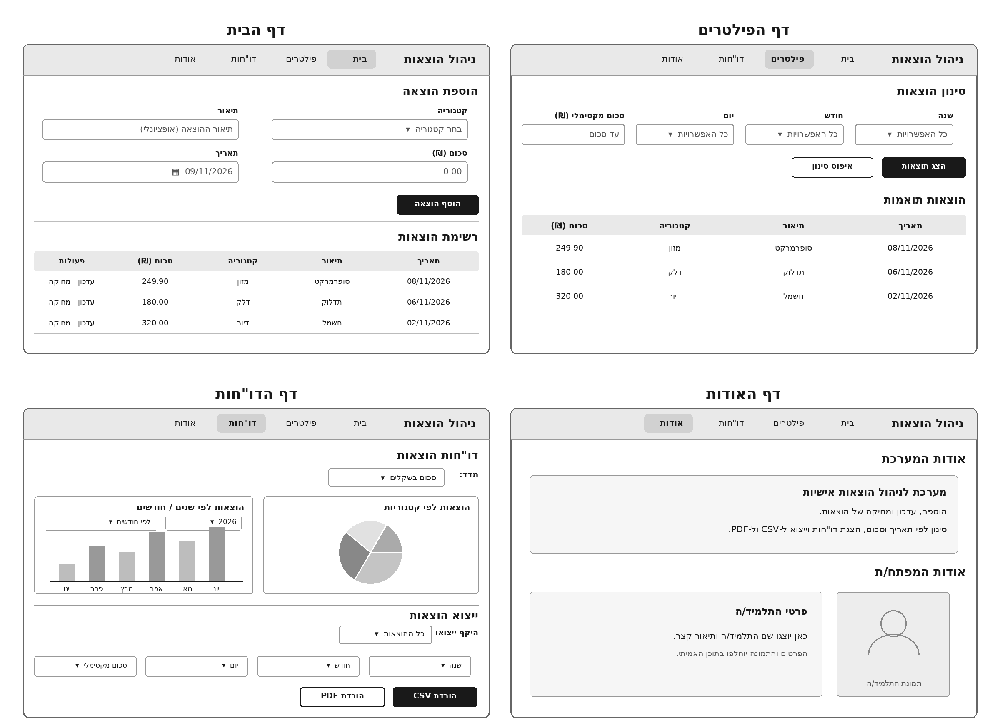
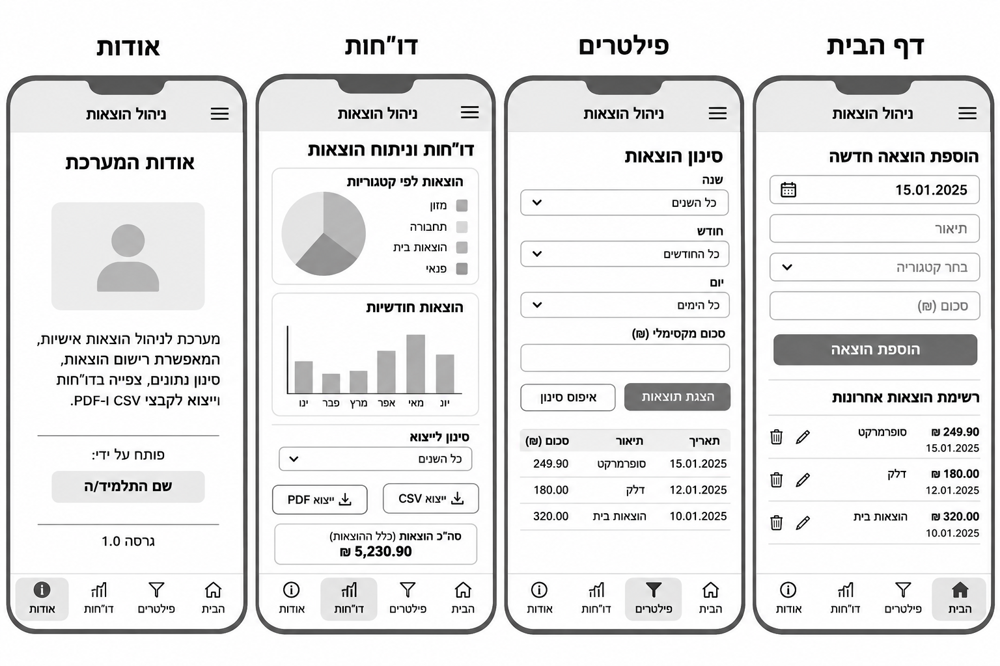
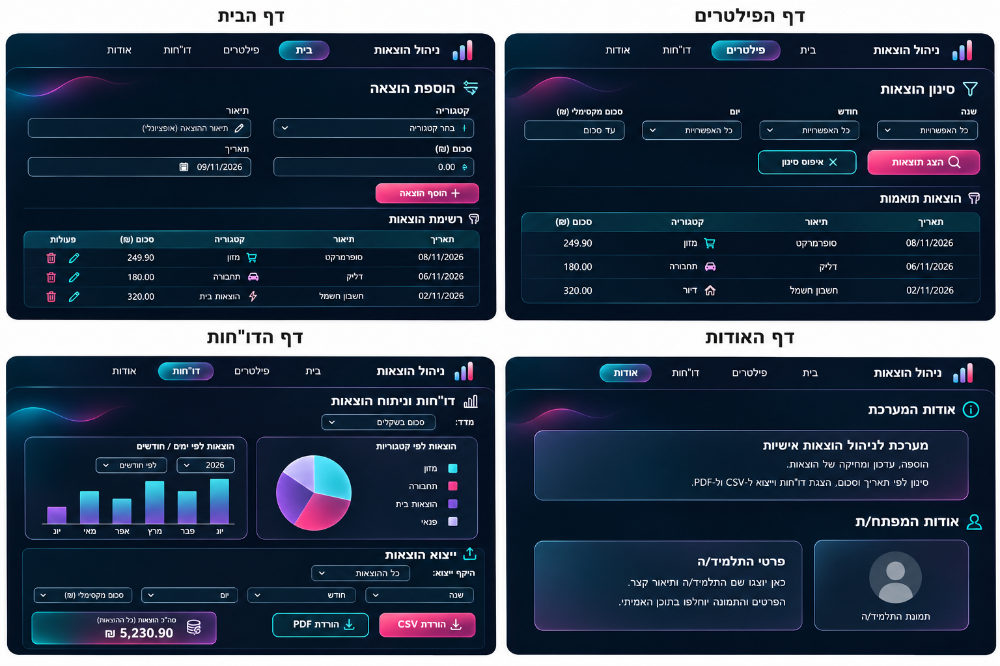
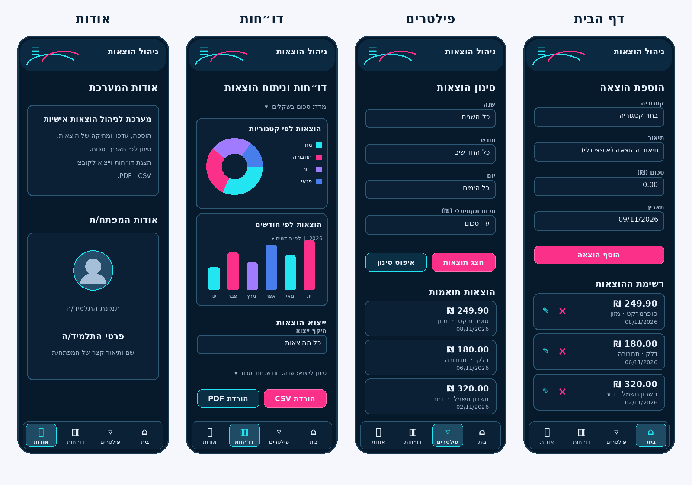
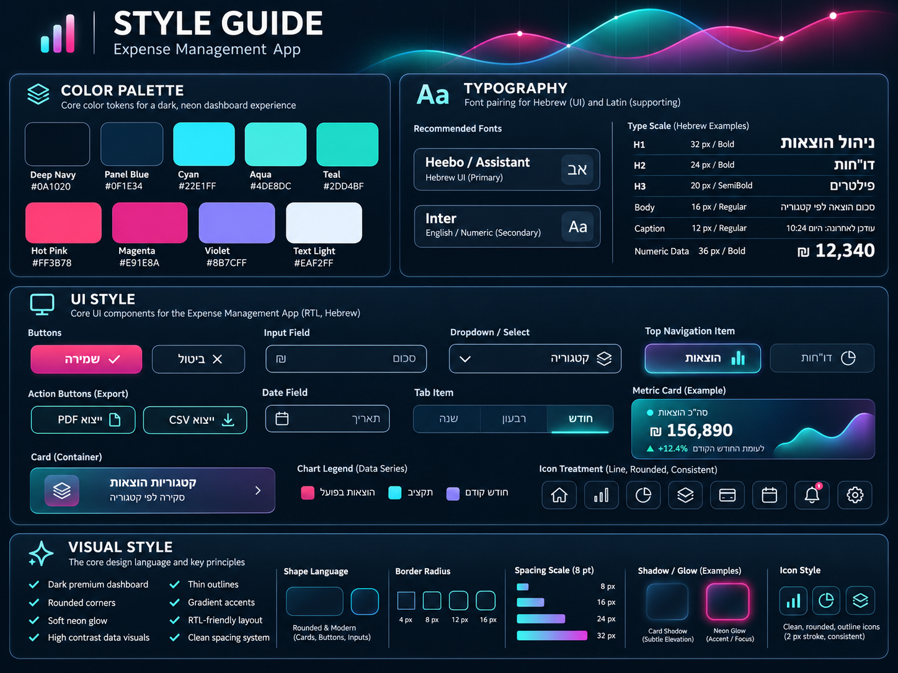

# DESIGN – מערכת ניהול הוצאות

מסמך זה מתאר את מימוש ממשק המשתמש של האתר הרספונסיבי לניהול הוצאות. **PRD.md** הוא המקור הקובע להתנהגות, לנתונים ולאילוצים; ה-Wireframes מגדירים את מבנה המסכים, ה-Style Guide מגדיר את השפה החזותית, וה-Mockups ממחישים את העיצוב. במקרה של הבדל בין המחשות חזותיות לבין דרישת מוצר, יש להיצמד ל-PRD, ללא הוספת יכולות חדשות.

## 1. Screens – מסכי האפליקציה

האפליקציה כוללת **ארבעה דפים בלבד**: **דף הבית**, **דף הפילטרים**, **דף הדו"חות**, **דף האודות**. חלון עריכת הוצאה ואישור מחיקה הם מצבים המופיעים מעל דף הבית, לא מסכים נוספים.

### מבנה המסכים – Wireframes

**Desktop** – מסכים בפריסת Grid, עם כותרת ותפריט ניווט אופקי משותפים:

**Mobile** – התאמה לרוחב Smartphone, עם תוכן אנכי, בקרות ברוחב זמין וניווט מותאם למובייל:

### 1.1 דף הבית

**מטרת המסך:** רישום הוצאה חדשה ועיון ברשימת ההוצאות הקיימות, כולל עדכון ומחיקה.

**מבנה ותוכן:**
- כותרת **"הוספת הוצאה"** מעל טופס. ב-Desktop שדות הטופס מסודרים בשתי עמודות: **"קטגוריה"**, **"תיאור"**, **"סכום (₪)"**, **"תאריך"**; כפתור **"הוסף הוצאה"** בסיום. שדות החובה וההתנהגות המותנית של התיאור נקבעים ב-PRD.
- מתחת לטופס, הפרדה חזותית ולאחריה כותרת **"רשימת הוצאות"** וטבלה הכוללת תאריך, תיאור, קטגוריה, סכום ופעולות.
- ברשימה מופיעים פקדי **"עדכון"** ו**"מחיקה"** לכל הוצאה, וכן מיון דרך כותרות העמודות הרלוונטיות.
- ב-Mobile הטופס והשדות מסודרים אנכית. ההוצאות מוצגות באופן המותאם לרוחב צר; פרטי ההוצאה והפעולות נשארים גלויים ונגישים, בלי לדחוס טבלת Desktop לרוחב הטלפון.

**פעולות וניווט:** הוספה דרך הטופס; עדכון דרך **Modal** הנפתח מתוך פריט; מחיקה לאחר **Dialog** אישור; מעבר לשאר הדפים דרך הניווט הראשי. אלה מצבי אינטראקציה של אותו מסך, ולא מסכים נפרדים.

### 1.2 דף הפילטרים

**מטרת המסך:** איתור הוצאות על פי תנאים משולבים.

**מבנה ותוכן:**
- כותרת **"סינון הוצאות"**.
- ארבעה שדות: **"שנה"**, **"חודש"**, **"יום"**, **"סכום מקסימלי (₪)"**. ב-Desktop הם מוצגים בשורה; ב-Mobile הם נערמים אנכית.
- כפתורים **"הצג תוצאות"** ו**"איפוס סינון"**.
- מתחת לאזור הסינון מופיעה כותרת **"הוצאות תואמות"** וטבלת תוצאות עצמאית, עם נתוני ההוצאה ומיון לפי כותרות.
- אם אין התאמות, מוצג טקסט ידידותי במקום תוצאות ריקות, לפי ה-PRD.

**פעולות וניווט:** בחירה או שילוב של תנאי סינון, הצגת תוצאות, איפוס בחירות ומיון. תוצאות המסך אינן משנות את נתוני הגרפים או את הפילטרים העצמאיים לייצוא בדף הדו"חות.

### 1.3 דף הדו"חות

**מטרת המסך:** המחשה גרפית של ההוצאות וייצוא הנתונים לקבצים.

**מבנה ותוכן:**
- כותרת **"דו"חות וניתוח הוצאות"** ואזור בחירת **"מדד"**, המאפשר הצגת סכום בשקלים או מספר הוצאות.
- שני אזורי תרשים: **"הוצאות לפי קטגוריות"** (Pie ומקרא קטגוריות) ו**"הוצאות לפי שנים / חודשים"** (גרף עמודות עם בחירת קיבוץ ובחירת שנה כאשר מוצגים חודשים).
- ב-Desktop אזורי התרשימים סמוכים זה לזה; ב-Mobile הם מוצגים זה תחת זה, ללא הקטנה שפוגעת בקריאות.
- אזור נפרד **"ייצוא הוצאות"** עם בחירה בין כלל ההוצאות להוצאות מסוננות, שדות **"שנה"**, **"חודש"**, **"יום"**, **"סכום מקסימלי (₪)"**, וכפתורי **"הורדת CSV"** ו**"הורדת PDF"**.
- במראה המדגים את המסך מופיע גם סיכום סכום ההוצאות. הוא רכיב המחשה בלבד ואין להוסיף בעקבותיו חישובים, סינון או יכולת מוצר שאינם מאושרים ב-PRD.

**פעולות וניווט:** מעבר בין שני סוגי מדדים ובין תצוגת שנים לחודשים; הורדת CSV או PDF. פילטרי הייצוא פועלים רק על תוכן הקבצים ולא על שני התרשימים.

### 1.4 דף האודות

**מטרת המסך:** הצגת הסבר קצר על המערכת והיכרות עם התלמיד/ה שפיתח/ה אותה.

**מבנה ותוכן:**
- כותרת **"אודות המערכת"** ומקטע טקסט המתאר את ייעוד האתר ואת האפשרויות המרכזיות שלו.
- כותרת **"אודות המפתח/ת"**, אזור לתיאור אישי ואזור תמונה של התלמיד/ה.
- ב-Desktop אזור התיאור ואזור התמונה יכולים להופיע זה לצד זה; ב-Mobile הם מסודרים אנכית.
- תמונת דמות גנרית ב-Mockup היא **Placeholder** בלבד; התמונה והתיאור בפועל יוחלפו בפרטים שיספק/תספק התלמיד/ה.

**פעולות וניווט:** קריאת התוכן ומעבר לשאר הדפים באמצעות הניווט המשותף. אין במסך זה טופס או פעולות ניהול נתונים.

### ניווט כללי ו-Responsive Layout

- **Desktop:** פס עליון עקבי המזהה את המוצר כ**"ניהול הוצאות"**, עם קישורים **"בית"**, **"פילטרים"**, **"דו"חות"**, **"אודות"**. הפריט הנוכחי מקבל הדגשה צבעונית ברורה.
- **Mobile:** ניווט קומפקטי עם אותם ארבעה יעדים; ה-Wireframe הנייד מראה פס ניווט תחתון, ולכן הוא נקודת הייחוס לתכנון הנייד. אין ליצור מסכים חדשים לצורך ניווט.
- הכותרות, פעולות המפתח ואזורים רבי-תוכן נשמרים באותה היררכיה בכל גדלי המסך. תוכן ארוך נגלל בתוך העמוד לפי הצורך.
- תצוגת מסך ריק, שגיאה, טעינה, Modal ואישור מחיקה אינן מסכים נוספים. הטקסטים והתנהגותם נקבעים ב-PRD.

### מראה המסכים – Mockups

**Desktop** – ההמחשה החזותית של ארבעת הדפים:

**Mobile** – ההמחשה המצורפת עבור גרסת המובייל:

> **הבהרה לגבי המקורות:** אם בתמונת Mockup ניידת רכיבים נראים בפריסת Desktop, יש לממש את **הפריסה והממדים לפי `wireframes-mobile.png`** ואת **הצבעים, הגופנים וסגנון הרכיבים לפי `style-guide.png`**. כך נשמרת התאמה ל-PRD גם כאשר ההמחשות אינן חופפות לחלוטין. יש להעדיף את שמות המסכים ומבנה ארבעת הדפים המוגדרים לעיל על פני כיתובים מקריים או אי-דיוקים בהדמיות.

## 2. Style Guide – השפה העיצובית

### מקור העיצוב

### 2.1 Color Palette

השפה מתבססת על **Dark Dashboard** עם רקע כחול-שחור, משטחים כחולים כהים והדגשות Neon ב-Cyan, Aqua, Teal, Pink ו-Violet. הערכים המפורשים בתמונת ה-Style Guide הם:

| Token | HEX | שימוש עיקרי |
|---|---|---|
| Deep Navy | `#0A1020` | רקע ראשי |
| Panel Blue | `#0F1E34` | משטחי Cards, אזורים ושדות |
| Cyan | `#22E1FF` | הדגשת מידע, קווי מתאר, אייקונים ופעולות משניות |
| Aqua | `#4DE8DC` | הדגשות משלימות בגרפים ובמעברי צבע |
| Teal | `#2DD4BF` | הדגשות ומצבים פעילים |
| Hot Pink | `#FF3B78` | פעולות ראשיות והדגשות בגרפים |
| Magenta | `#E91E8A` | Gradient של כפתורים והבלטות |
| Violet | `#8B7CFF` | סדרות נתונים והדגשות ב-Cards |
| Text Light | `#EAF2FF` | טקסט ראשי על משטח כהה |

- לחצנים ראשיים משתמשים ב-Pink/Magenta; פעולות משניות ב-Cyan וב-Outline בהיר.
- שימוש ב-Gradient וב-Glow הוא **ממוקד** בכפתורים, מצב ניווט נבחר, כרטיסי מדדים ותרשימים; לא כל הרכיבים זוהרים.
- טקסט משני יכול להיות בגוון בהיר ומעומעם ביחס ל-Text Light; לא הוגדר לו HEX מחייב במקור, ולכן אין להציג ערך שרירותי כ-Design Token מאושר.
- בגרפים יש להשתמש בצבעים מובחנים מהפלטה עם מקרא ברור, לצד סימון מספרי או תוויות, ולא להסתמך על צבע בלבד.

### 2.2 Typography

| רמה | גודל ומשקל | שימוש |
|---|---|---|
| H1 | `32px / Bold` | כותרת ראשית |
| H2 | `24px / Bold` | כותרות מקטעים |
| H3 | `20px / Semibold` | כותרות Cards ורכיבים |
| Body | `16px / Regular` | תיאורים, טפסים, טבלאות |
| Caption | `12px / Regular` | מידע משני ותוויות קצרות |
| Numeric Data | `36px / Bold` | מדד מספרי מרכזי, כשקיים |

- **גופן עברי ראשי:** `Heebo` או `Assistant`, בהתאם לחלופות המופיעות ב-Style Guide; יש להשתמש במשפחה עברית אחת באופן עקבי ברכיבי הממשק.
- **גופן משני לאנגלית ולספרות:** `Inter`, כאשר ניתן לשמור על גופן עברי אחיד גם בסמוך למספרים כדי למנוע חוסר עקביות.
- היררכיה באמצעות משקל, גודל, מרווחים וניגודיות; להימנע מהדגשת יתר בכל פסקה.

### 2.3 UI Style

**כפתורים:** מלבנים מעוגלים, Primary בעל מילוי Pink–Magenta, Secondary כהה עם קו Cyan או קו בהיר. מצב נבחר או Focus מודגש בקו/Glow; שמות הפעולות בעברית. כפתורי CSV/PDF תואמים לסגנון Secondary עם אייקון הורדה.

**שדות וטפסים:** שדות כהים, מסגרת דקה ובולטת, פינות מעוגלות ותווית עברית מעל או לצד השדה. Dropdown ו-Date Field תואמים לאותו מבנה, עם אייקון תפקודי בלבד. שדות חובה, שגיאות ולידציה ותאריכים ממשיכים לפעול לפי ה-PRD.

**Cards ו-Panels:** משטחי Panel Blue על Deep Navy, גבול דק כחול-בהיר, Radius מתון, לעיתים Gradient פנימי או Glow עדין. הטבלאות מחולקות לשורות ברורות; כותרת הטבלה בולטת ביחס לשורותיה.

**ניווט:** בר Desktop עליון עם הדגשה זוהרת ומתונה לפריט הפעיל; במובייל ניווט תחתון קומפקטי בהתאם ל-Wireframe. טקסט ואייקונים נשמרים ברורים גם ללא Glow.

**אייקונים:** אייקוני Outline נקיים, מעוגלים ועקביים, בקו בעובי אופייני של כ-`2px`. אייקוני פעולה מובחנים לפי משמעותם, כגון עריכה, מחיקה, לוח שנה, סינון והורדה; אין להוסיף פעולות רק כדי לשלב אייקונים.

**גרפים:** רקע כהה, עמודות בגווני Cyan/Pink/Violet, Pie רב-צבעי מאותה פלטה, גבולות ומקרא קריאים. שינוי מדד או קיבוץ משנה את הנתונים לפי ה-PRD, לא את שפת העיצוב.

### 2.4 Visual Style, Layout ו-Spacing

- **אווירה:** מקצועית, דיגיטלית, עשירה בנתונים, כהה ועתידנית בעדינות; קווי Neon דקים ומעברי צבע נעימים, בדומה לתמונת ההשראה.
- **Shape Language:** מלבנים ופינות מעוגלות, עם דגש על Cards, Inputs וכפתורים. רדיוסים המודגמים במקור: `4px`, `8px`, `12px`, `16px`; יש להקצות אותם לפי גודל ותפקיד הרכיב.
- **Spacing:** סולם מבוסס יחידות של `8px`, עם דוגמאות `8px`, `16px`, `24px`, `32px`. המרווחים יוצרים הפרדה בין טופס, טבלה, תרשימים וייצוא.
- **Borders:** קווי Outline דקים בגוון כחול/Cyan; הטיפול במצב פעיל ו-Focus כולל Glow נקודתי, לא צל כבד בכל רכיב.
- **Shadows:** Shadow מעודן לכרטיסים, ו-Neon Glow מודגש רק להדגשה ולמוקדי פעולה.
- **Desktop Layout:** אזורי תוכן רחבים, טפסים ופקדי סינון במספר עמודות כשהרוחב מאפשר זאת, ושני תרשימים זה לצד זה.
- **Mobile Layout:** תוכן בערימה אנכית, מרווחים עקביים, רכיבים לחיצים נוחים, תרשימים וכרטיסים ברוחב המכשיר, ורשימת הוצאות קריאה. אין לכפות את מידות ה-Desktop על Mobile.
- **תמונות ואיורים:** ללא תמונות דקורטיביות כחלק מן הממשק; בדף האודות קיימת תמונת תלמיד/ה בהתאם ל-PRD. קווי גל זוהרים מופיעים כהדגשה גרפית מינורית ב-Mockups, ולא כרכיב תוכן או פעולה.

### 2.5 שפה וכיווניות

- שפת הממשק היא **עברית בלבד**, ו-Layout ברירת המחדל הוא **RTL**.
- כותרות, תוויות, הודעות, תפריטים, טפסים וטבלאות מיושרים לכיוון הקריאה בעברית.
- מספרים, סכומי `₪`, תאריכים, `CSV` ו-`PDF` שומרים על סדר תווים קריא בתוך RTL באמצעות בידוד כיווניות נקודתי לפי הצורך; אין להפוך ספרות או סימני פיסוק.
- **כותרות הקטגוריות במסמך** נשארות באנגלית כמונחים מקצועיים; **טקסטי ממשק המשתמש** נשארים בעברית.

---

**עקרון המימוש:** לפתח ארבעה מסכים בלבד, לקחת את ההיררכיה והרכיבים מן ה-Wireframes, ליישם את ה-Color Palette וה-Typography מן ה-Style Guide, ולהיעזר ב-Mockups להשלמת המראה. דרישות התנהגות, הרשאות, גישה לנתונים ופעולות נשארות בסמכות ה-PRD וה-ARCHITECTURE, ולא נגזרות מהדמיות חזותיות בלבד.
