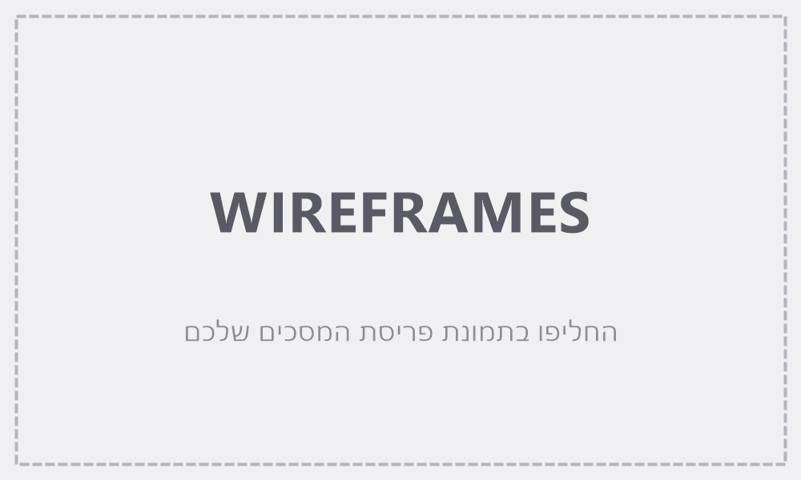
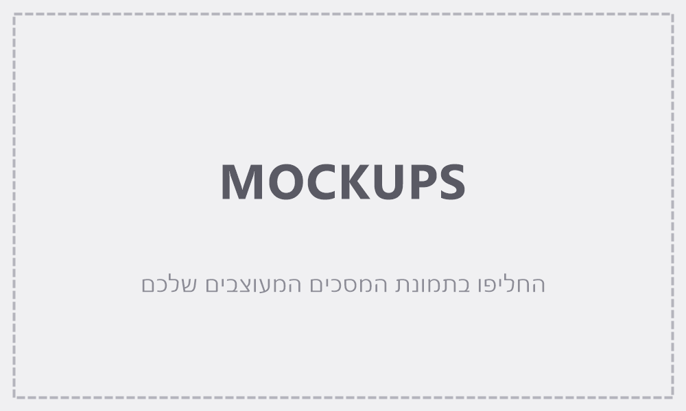

# Design (UI / UX)

> עיצוב האפליקציה, בשני חלקים: ה-**מסכים** (Screens) וה-**Style Guide**. המסמך מתבסס על ה-PRD ועל תמונות הייחוס שבתיקיית `spec/`.
>
> **מצב התמונות:** כל התמונות עדיין placeholders. חלק המסכים נכתב לפי ה-PRD, וה-Style Guide לפי ההעדפות שהמשתמש בחר: סגנון צבעוני וחי, צבע ראשי ירוק, וסרגל לשוניות בתחתית המסך בטלפון. כשהתמונות יוחלפו, הן מנצחות לפי כללי הסתירות ב-`CLAUDE.md`, וצריך לעדכן את המסמך בהתאם.

## 1. Screens – מסכי האפליקציה

### Wireframes (מבנה ופריסה)

### Mockups (המראה הסופי)

### רשימת המסכים

#### התחברות
- **מטרת המסך:** כניסה לאפליקציה.
- **מבנה ותוכן:** שם האפליקציה בראש המסך. מתחתיו שדה אימייל, שדה סיסמה וכפתור "כניסה" ברוחב מלא. מקום להודעת שגיאה מעל הכפתור. אין קישור להרשמה.
- **פעולות וניווט:** כניסה מוצלחת מעבירה למסך הסיכום. פרטים שגויים מציגים את ההודעה "אימייל או סיסמה שגויים".

#### סיכום חודשי (מסך הבית)
- **מטרת המסך:** לראות במבט אחד כמה נכנס, כמה יצא, ולאן הלך הכסף החודש.
- **מבנה ותוכן:**
  - **בורר חודש** בראש המסך: חץ לחודש הקודם, שם החודש והשנה (למשל "נובמבר 2026"), וחץ לחודש הבא. החץ לחודש הבא לא זמין כשמוצג החודש הנוכחי.
  - **שלושה כרטיסי סכום:**
    - הכנסות, בירוק.
    - הוצאות, באדום.
    - יתרה: כרטיס גדול ובולט. ירוק כשהיתרה חיובית, אדום כשהיא שלילית.
  - **גרף טבעת (Donut)** של הוצאות החודש לפי קטגוריה, עם סך ההוצאות במרכז.
  - **מקרא מתחת לגרף:** שורה לכל קטגוריה, עם נקודת צבע, שם, סכום ואחוז. מסודר מהגבוה לנמוך.
- **פעולות וניווט:** מעבר בין חודשים. לחיצה על קטגוריה במקרא פותחת את מסך הרישומים של אותו חודש, מסונן לקטגוריה. כפתור "הוספה" בסרגל התחתון.

#### רישומים
- **מטרת המסך:** לראות, לתקן ולמחוק את ההוצאות וההכנסות של חודש.
- **מבנה ותוכן:**
  - בורר חודש, זהה למסך הסיכום.
  - שורת סינון לפי קטגוריה ("הכל" כברירת מחדל).
  - רשימה מקובצת לפי תאריך, מהחדש לישן, עם כותרת לכל יום.
  - **כל שורה כוללת:**
    - עיגול בצבע הקטגוריה.
    - שם הקטגוריה.
    - הסכום: הכנסה בירוק עם "+", הוצאה באדום עם "−".
    - סימן קטן 🔁 לרישום שנוצר מהוצאה קבועה.
- **פעולות וניווט:** לחיצה על שורה פותחת את טופס הרישום במצב עריכה.

#### טופס רישום (הוספה ועריכה)
- **מטרת המסך:** לרשום הוצאה או הכנסה במהירות, או לתקן רישום קיים.
- **מבנה ותוכן:**
  - **בטלפון:** חלון שעולה מתחתית המסך (Bottom sheet).
  - **במחשב:** חלון במרכז המסך.
  - **מתג בראש הטופס:** "הוצאה" / "הכנסה". ברירת המחדל היא "הוצאה".
  - **שדה סכום גדול** עם סימן ₪. מקלדת מספרים נפתחת אוטומטית בטלפון.
  - **תאריך:** ברירת המחדל היא היום.
  - **קטגוריות:** "כפתורי צ'יפ" צבעוניים של הקטגוריות המתאימות לסוג שנבחר.
  - **כפתור "שמירה"** ברוחב מלא.
  - **במצב עריכה בלבד:** כפתור "מחיקה" בצבע אדום, בתחתית.
- **פעולות וניווט:**
  - שמירה סוגרת את הטופס ומציגה הודעה קצרה ("נשמר").
  - מחיקה פותחת חלון אישור.
  - שגיאת תקינות מוצגת מתחת לשדה הרלוונטי.

#### הוצאות קבועות
- **מטרת המסך:** לנהל את ההוצאות שנרשמות לבד כל חודש.
- **מבנה ותוכן:**
  - רשימת כרטיסים. כל כרטיס כולל קטגוריה, סכום ו"בכל חודש ב-<יום>", ומתג פעיל/מופסק. כרטיס מופסק מוצג באפור.
  - **כפתור "הוצאה קבועה חדשה"** פותח טופס עם:
    - סכום.
    - קטגוריה, מתוך קטגוריות ההוצאה.
    - יום בחודש, בבורר ימים 1–31.
    - הערה קבועה מתחת לבורר: "אם אין יום כזה בחודש, ההוצאה תירשם ביום האחרון של החודש".
- **פעולות וניווט:** לחיצה על כרטיס פותחת עריכה. הטופס מציין ש"שינויים חלים מהחודש הבא ואילך".

#### קטגוריות
- **מטרת המסך:** להוסיף, לשנות שם ולמחוק קטגוריות.
- **מבנה ותוכן:** שתי לשוניות בראש המסך: "הוצאות" ו"הכנסות". רשימת הקטגוריות, כל אחת עם עיגול צבע ושם. כפתור "קטגוריה חדשה".
- **פעולות וניווט:**
  - לחיצה על קטגוריה פותחת עריכת שם וכפתור מחיקה.
  - מחיקת קטגוריה שיש בה רישומים פותחת חלון שמבקש לבחור קטגוריה אחרת שאליה יועברו הרישומים.
  - שם כפול מציג את השגיאה "כבר יש קטגוריה בשם הזה".

#### ייבוא קובץ
- **מטרת המסך:** להכניס עסקאות מקובץ של הבנק או של כרטיס האשראי. מותאם בעיקר למחשב, ועובד גם בטלפון.
- **מבנה ותוכן:** אשף של שלושה שלבים, עם מחוון שלבים בראש המסך:
  1. **בחירת קובץ:** אזור גדול "גרור קובץ לכאן או לחץ לבחירה" (Excel / CSV).
  2. **התאמת עמודות:**
     - בחירה מתוך רשימה: איזו עמודה בקובץ היא התאריך ואיזו היא הסכום.
     - בחירה איך לקבוע את הסוג: "הכל הוצאות", "הכל הכנסות", או "לפי סימן הסכום".
     - תצוגה של 3 השורות הראשונות בקובץ, כדי לראות שההתאמה נכונה.
  3. **תצוגה מקדימה ואישור:**
     - טבלה של כל העסקאות. בכל שורה: תאריך, סכום, סוג, בורר קטגוריה ותיבת סימון "לייבא".
     - שורה שנראית כפולה מסומנת ברקע צהוב עם התווית "ייתכן שכפולה", ותיבת הסימון שלה **לא** מסומנת כברירת מחדל.
     - שורה לא תקינה מוצגת באפור עם הסבר, ולא ניתנת לסימון.
     - כפתור להחלת קטגוריה אחת על כל השורות המסומנות.
     - כפתור "ייבא <מספר> עסקאות".
- **פעולות וניווט:**
  - אפשר לחזור לשלב קודם.
  - בסיום מוצגת הודעה "יובאו X עסקאות", וכפתור למעבר למסך הרישומים.
  - קובץ לא קריא מציג הודעת שגיאה ונשאר בשלב 1.

#### עוד
- **מטרת המסך:** גישה למסכים שמשתמשים בהם לעתים רחוקות.
- **מבנה ותוכן:** רשימת קישורים: "קטגוריות", "ייבוא קובץ" ו"התנתקות".
- **פעולות וניווט:** מעבר למסכים האלה. התנתקות מחזירה למסך ההתחברות.

### מצבים מיוחדים (בכל המסכים)
- **טעינה:** שלד אפור מהבהב (Skeleton) במקום הכרטיסים והשורות.
- **אין נתונים:**
  - איור קטן או אייקון, עם טקסט הסבר וכפתור פעולה.
  - למשל: "אין רישומים בחודש הזה", עם כפתור "הוסף רישום".
  - במסך הסיכום מוצגים אפסים, והגרף מוחלף בהודעה.
- **שגיאה או אין אינטרנט:** פס הודעה אדום בראש המסך, "לא הצלחנו לשמור — בדוק את החיבור לאינטרנט ונסה שוב". הטופס נשאר פתוח עם מה שהוקלד.
- **אישור מחיקה:** חלון קטן, עם כותרת "למחוק?", הסבר קצר, כפתור "מחיקה" אדום וכפתור "ביטול".

### מבנה הניווט
- **בטלפון:** סרגל לשוניות קבוע בתחתית המסך. מימין לשמאל: **סיכום** · **רישומים** · **➕ הוספה** · **קבועות** · **עוד**.
  - כפתור ההוספה עגול, ירוק ובולט באמצע הסרגל, ופותח את טופס הרישום מכל מסך.
- **במחשב:** אותן לשוניות מוצגות כתפריט צד קבוע בצד ימין, עם כפתור "הוספה" ירוק בראשו. התוכן מוצג במרכז, ברוחב מקסימלי של כ-960px.
- **מסך ההתחברות** מוצג בלי ניווט.

---

## 2. Style Guide – השפה העיצובית

### Color Palette

| צבע / תפקיד | HEX |
|-------------|-----|
| Primary: כפתורים ראשיים, כפתור ההוספה, לשונית פעילה | `#15803D` |
| Primary Light: רקע לרכיב נבחר וצ'יפ פעיל | `#DCFCE7` |
| Income: סכומי הכנסות ויתרה חיובית | `#15803D` |
| Expense: סכומי הוצאות, יתרה שלילית, כפתור מחיקה | `#DC2626` |
| Warning: "ייתכן שכפולה" (רקע / טקסט) | `#FEF3C7` / `#B45309` |
| Background: רקע האפליקציה | `#F6FAF7` |
| Surface: כרטיסים וחלונות | `#FFFFFF` |
| Text: טקסט ראשי | `#1F2937` |
| Text Muted: טקסט משני ותוויות | `#6B7280` |
| Border | `#E5E7EB` |

**צבעי קטגוריות:** הצבעים של הגרף ושל עיגולי הקטגוריה. כל קטגוריה מקבלת צבע לפי הסדר, ובקטגוריה התשיעית מתחילים מחדש.

`#F97316` כתום · `#3B82F6` כחול · `#A855F7` סגול · `#EC4899` ורוד · `#14B8A6` טורקיז · `#EAB308` צהוב · `#6366F1` אינדיגו · `#84CC16` ליים

כל שילוב של טקסט על רקע עומד ביחס ניגודיות של 4.5:1 לפחות. לכן הירוק הראשי כהה מעט (`#15803D`), כדי שטקסט לבן על כפתור ירוק יהיה קריא.

### Typography
- **גופן:** Rubik (Google Fonts). תומך בעברית ובאנגלית, ומעוגל מעט, כך שמתאים לאווירה חיה.
- **גדלים:**
  - סכום ראשי (יתרה, שדה הסכום בטופס): 32px, משקל 700.
  - כותרת מסך: 22px, משקל 600.
  - סכומים בכרטיסים: 20px, משקל 600.
  - טקסט רגיל ושדות קלט: 16px. לא פחות, כדי שהטלפון לא יבצע זום בזמן הקלדה.
  - טקסט משני ותוויות: 14px.
- **מספרים:** ספרות ברוחב אחיד (tabular), כדי שסכומים ברשימה יהיו מיושרים. פורמט הסכום הוא `₪1,234.50`. אם אין אגורות, הן לא מוצגות (`₪1,234`).

### UI Style
- **כפתורים:**
  - ראשי: רקע ירוק, טקסט לבן.
  - משני: מסגרת ירוקה, טקסט ירוק.
  - מחיקה: רקע אדום.
  - כל הכפתורים בגובה 48px לפחות, נוח ללחיצה באגודל, עם פינות מעוגלות של 12px.
- **שדות:** רקע לבן, מסגרת אפורה ופינות של 12px. בפוקוס המסגרת ירוקה. התווית מוצגת מעל השדה.
- **כרטיסים:** רקע לבן, פינות של 16px וצל רך.
- **כרטיסי הסכום במסך הסיכום:** פס צבע עליון דק, ירוק להכנסות ואדום להוצאות.
- **צ'יפים של קטגוריות:**
  - כדור צבע ושם, בתוך כמוסה מעוגלת.
  - צ'יפ נבחר: רקע `#DCFCE7` ומסגרת ירוקה.
- **אייקונים:** קוויים ופשוטים (סגנון Lucide).
- **הודעות קצרות (Toast):** מופיעות בתחתית המסך, מעל סרגל הלשוניות, ונעלמות אחרי 3 שניות.

### Visual Style
- **אווירה:** צבעונית וחיה אבל לא עמוסה. הצבע מגיע מהקטגוריות, מהגרף ומכפתורי הפעולה, והרקע נשאר בהיר ורגוע.
- **צורות:** פינות מעוגלות בכל הרכיבים ללא קווי מתאר כבדים. ההפרדה בין רכיבים נעשית בעיקר באמצעות צל רך ורווח.
- **מרווחים:** בסיס של 4px. מרווח פנימי בכרטיס הוא 16px, ובין כרטיסים 12–16px. בצדי המסך בטלפון יש 16px.
- **פריסה:**
  - בטלפון: עמודה אחת.
  - במחשב: כרטיסי הסכום בשורה אחת, והגרף והמקרא זה לצד זה.
- **איורים:** אייקונים גדולים ופשוטים במצבי "אין נתונים", בלי תמונות.

### שפה וכיווניות
- **שפת הממשק:** עברית. כיווניות: RTL. היישור הוא לימין.
- **הניווט:** תפריט הצד במחשב נמצא מימין. החץ לחודש הקודם מצביע ימינה, והחץ לחודש הבא שמאלה.
- **סכומים ותאריכים:** מוצגים בכיוון LTR בתוך הטקסט העברי, כדי שהסימנים והספרות לא יתהפכו. דוגמאות: `‎-₪250`, `‎09/11/2026`.
- **אייקונים כיווניים** (חצים, "חזרה") מתהפכים בהתאם ל-RTL. אייקונים שאינם כיווניים לא מתהפכים.
